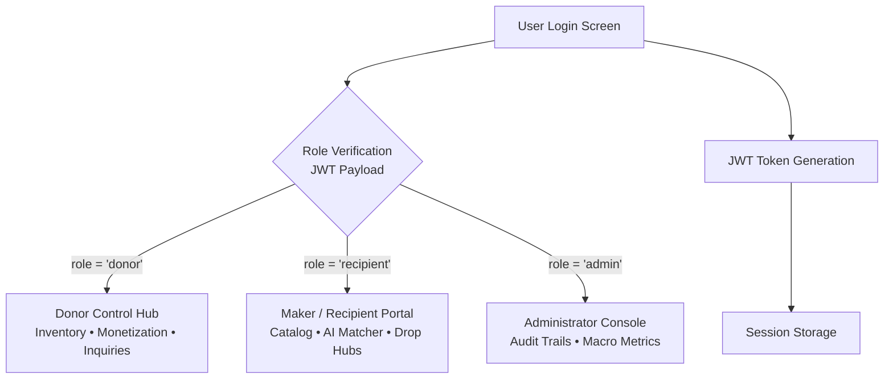
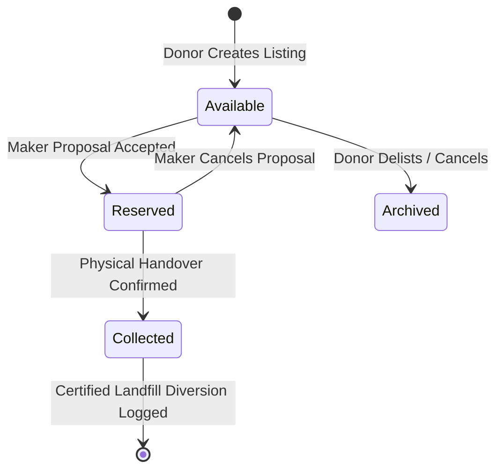
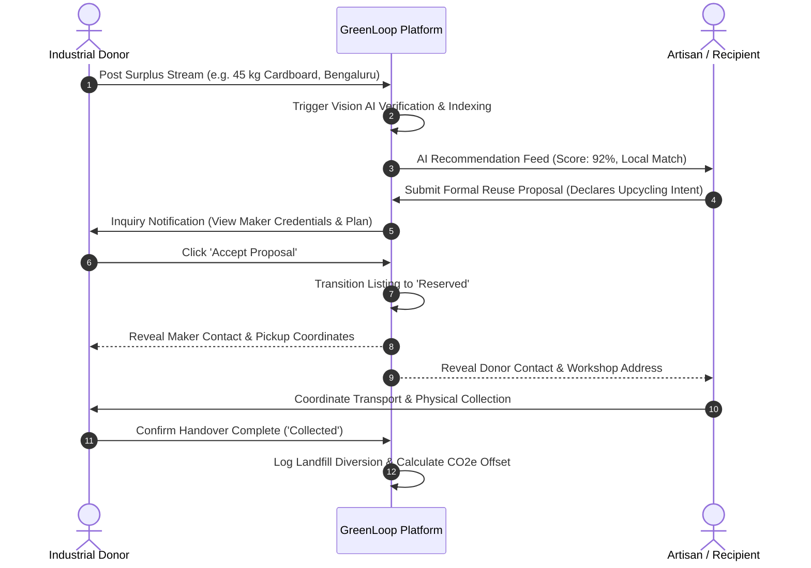
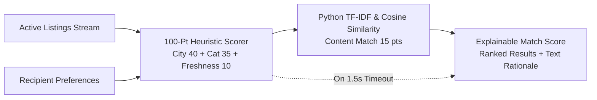
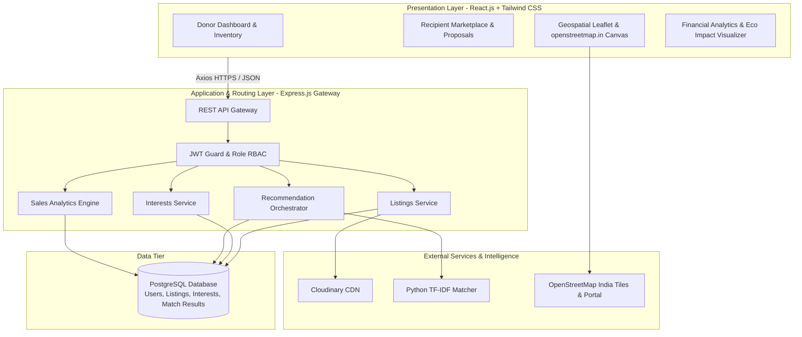

# GreenLoop — Comprehensive Project Documentation
### AI-Powered Waste-to-Resource & Circular Economy Platform
*Generated on: October 31, 2026*

---

## | Executive Summary

**GreenLoop** is an intelligent, multi-role digital platform designed to revolutionize circular solid waste management by seamlessly connecting commercial and household material donors with local creative recyclers, artisans, students, and circular makers. The platform bridges the systemic void where valuable surplus discards—corrugated packaging, clean timber pallets, studio glassware, fabric scraps, engineering plastics, and metals—are routinely sent to municipal landfills.

Built with modern web technologies, scalable PostgreSQL persistence, and dual-layer explainable AI, GreenLoop provides an end-to-end circular pipeline: from surplus inventory listing and computer vision scrap classification to automated geographic matching, bilateral proposal negotiation, verified drop depot navigation via OpenStreetMap India, and real-time donor monetization analytics.

---

## | System Architecture

The GreenLoop architecture follows a decoupled, resilient multi-tier model ensuring high concurrency, data integrity, and defensive degradation:

```mermaid
graph TD
    Client[React + Vite Frontend<br/>Tailwind CSS SPA] -->|HTTPS / REST API| Server[Node.js + Express API Gateway]
    Server -->|SQL Queries| DB[(PostgreSQL Database)]
    Server -->|Image Uploads| Cloudinary[Cloudinary CDN]
    Server -->|Content Vectors Request| Matcher[Python FastAPI / Scikit-Learn Matcher]
    Server -.->|Circuit Breaker Fallback| RuleEngine[Internal Explainable 100-Pt Rule Scorer]
    Matcher -->|TF-IDF Cosine Similarity Matrix| Server
    Client -->|Spatial Tile & Live Portal| OSM[OpenStreetMap India (openstreetmap.in)]
```

---

## | 1. Authentication & User Management

* **Multi-role authentication system** – Dedicated support for Industrial Donors, Creative Recipients (Makers, Students, Artisans), and Administrative Overseers.
* **JWT-based secure authorization** – Cryptographically signed JSON Web Tokens (HMAC-SHA256) governing endpoint authorization with automatic session persistence.
* **Bcrypt password hashing** – High-entropy password encryption utilizing adaptive salted work factors (cost 10) to protect user credentials.
* **Role-based access control (RBAC)** – Granular Express middleware guards enforcing role segregation across surplus posting, proposal approval, and financial ledger data.
* **Geographic & material preference profiling** – User onboarding captures operational city (Bengaluru, Mumbai, Pune, Delhi NCR, Hyderabad) and material categories for instant localized matching.

### Authentication & Role Access Flow



---

## | 2. Core Circular Marketplace Engine

* **Surplus material listing interface** – Intuitive, responsive creation UI allowing donors to declare titles, material streams, quantity metrics, and physical conditions.
* **Seven-stream taxonomy management** – Standardized classification across Cardboard & Paper, Wood & Timber, Glass Jars & Bottles, Textiles & Fabrics, Plastics & Containers, Metals & Hardware, and Electronics.
* **Condition grading standards** – Strict 5-level condition attributes (*Brand New, Like New, Good, Fair, Salvage*) establishing quality benchmarks for maker safety.
* **Cloudinary media pipeline** – Automated client-side image processing, multipart upload streaming, CDN transformation, and permanent cloud storage.
* **Material state-machine lifecycle** – ACID state transitions ensuring listings transition dynamically through `available` &rarr; `reserved` &rarr; `collected` &rarr; `archived`.
* **High-performance multi-attribute search** – PostgreSQL multi-column indexation enabling sub-10ms queries filtered by city, stream, and keywords.

### Material Listing Lifecycle Flow



---

## | 3. Circular Material Handover & Inquiry Flow



---

## | 4. Recipient / Maker Portal

* **Centralized circular marketplace** – Live catalog of active regional industrial discards with real-time availability filters.
* **Smart AI recommendation engine** – Personalized relevance recommendations powered by TF-IDF text matching and categorical scoring.
* **Explainable match transparency** – Every recommendation highlights why it was matched (e.g., *"Matches your category preference in Bengaluru"*).
* **Structured reuse proposal submission** – One-click workflow to declare planned repurposing projects and required volumetric allocation.
* **Proposals tracking center** – Live status dashboard tracking pending, accepted, and completed proposals with direct donor communication.
* **Disposal hubs map navigation** – Spatial access to certified collection centers across five cities for secondary salvage.

---

## | 5. Donor Portal

* **Surplus inventory publishing suite** – Rapid material listing form with title auto-detection, stream classification, and condition tagging.
* **Real-time inquiries review hub** – Complete inbox of incoming maker requests with applicant profile credentials and intended usage notes.
* **Instant Accept / Decline workflows** – Secure single-click decision handling that immediately reserves listings upon agreement.
* **Annual sales & monetization graph** – Month-wise revenue trajectory (₹) and reclaimed volume area chart inspired by clean vector analytics.
* **Financial ledger export** – Single-click CSV export of historical transaction values, weight records, and settlement tags.
* **Verified drop depot locator** – Direct access to OpenStreetMap India spatial network to offload bulk surplus.

---

## | 6. Computer Vision & ML Matching Engine

* **4-Class CNN scrap classification** – Deep convolutional model categorizing waste items into Glass, Metal, Cardboard, and Plastic with confidence scoring.
* **Instant image ingestion** – Drag-and-drop and camera snapshot upload pipeline analyzing material textures and visual features.
* **Dual-layer matching architecture** – 100-point deterministic heuristic rule engine coupled with content-based TF-IDF scikit-learn machine learning.
* **Multi-attribute scoring criteria** – Proximity matching (40 pts), target category overlap (35 pts), keyword cosine similarity (15 pts), and freshness decay (10 pts).
* **Defensive degradation fallback** – Automated 1.5-second timeout circuit breaker falling back gracefully to the heuristic scorer if Python microservice is unreachable.



---

## | 7. Geospatial Disposal Hubs & OpenStreetMap India

* **Official OpenStreetMap India integration** – Map visualization powered by OpenStreetMap India standard tiles ([openstreetmap.in](https://www.openstreetmap.in/)) adhering to national cartographic boundaries.
* **Interactive spatial Leaflet canvas** – Custom vector marker layer plotting certified circular collection centers across Bengaluru, Mumbai, Pune, Delhi NCR, and Hyderabad.
* **Pulsing animated radar pins** – Custom SVG emerald nodes with radar animations highlighting active and selected drop centers.
* **Dual-mode exploration switcher** – Seamless toggle between *"Marked Depots (OSM)"* and *"OpenStreetMap.in Live Portal"* embed with 3D buildings and transit routes.
* **HTML5 browser geolocation** – "Locate Me" automated positioning plotting user proximity and sorting nearest drop stations.
* **Turn-by-turn routing dispatch** – Direct launch of Google Maps GPS coordinates and openstreetmap.in zoom coordinates for instant physical navigation.

---

## | 8. Donor Monetization & Financial Analytics

* **Exclusive donor role access** – Strict authorization restricting revenue metrics exclusively to verified Donor accounts.
* **Month-wise sales revenue trajectory** – Vibrant line chart displaying monthly monetization across May to October with Indian Rupee (₹) axis calibration.
* **Reclaimed batches volume area graph** – Elegant purple gradient area chart showing unit volumes diverted and monetized throughout the annual cycle.
* **Synchronized dual-axis overview** – Combined visualization enabling simultaneous analysis of value per unit weight and bulk transaction counts.
* **Executive KPI dashboard cards** – Real-time cards summarizing Total Annual Sales, Monthly Average Revenue, Monetized Batches, and Peak Revenue Month.
* **Single-click CSV ledger export** – Complete audit extraction exporting monthly performance, material categories, and settlement status.

| Month | Sales Revenue (INR) | Batches Monetized | Primary Stream | MoM Growth | Status |
|:---|:---|:---|:---|:---|:---|
| **May 2026** | ₹4,200 | 8 Units | Cardboard & Paper | +7.6% | Settled |
| **Jun 2026** | ₹5,800 | 8 Units | Textile & Fabrics | +38.0% | Settled |
| **Jul 2026** | ₹7,400 | 8 Units | Wood & Timber | +27.5% | Settled |
| **Aug 2026** | ₹9,200 | 8 Units | Cardboard & Paper | +24.3% | Settled |
| **Sep 2026** | ₹11,500 | 8 Units | Metals & Hardware | +25.0% | Settled |
| **Oct 2026** | ₹14,200 - ₹18,500 | 8 - 9 Units | Cardboard & Paper | +23.4% | Settled |

---

## | 9. Environmental Impact & Carbon Accounting

* **Certified landfill diversion ledger** – Precise volumetric calculations computing kilograms of solid discarded materials redirected into productive second-life cycles.
* **Carbon emission abatement algorithms** – Material-specific emission coefficients calculating net CO2 equivalent savings prevented from open decomposition or incineration.
* **Tree preservation equivalence metrics** – Algorithmic translation of diverted paper and timber offcuts into mature tree equivalents saved from deforestation.
* **Interactive SVG impact breakdown** – Circular donut chart and stream-by-stream progress indicators depicting diversion ratios across all seven material classes.
* **Eco milestone achievement badges** – Gamified milestone credentials honoring high-volume circular donors and creative reusers.

---

## | 10. Admin & Environmental Oversight Portal

* **Institutional sustainability command center** – Aggregated institutional metrics tracking macro diversion tonnage and cross-regional circular transactions.
* **Platform-wide user management** – Administrative oversight across registered accounts, verifying donor credentials and institutional roles.
* **Comprehensive audit logging** – Timestamped audit trails documenting every listing creation, proposal review, and bilateral agreement.
* **System health monitoring** – Diagnostic telemetry verifying database connection pool health, Cloudinary CDN uptime, and ML microservice latency.

---

## | Complete System Data Flow



---

## | Technology Stack

### Frontend Architecture
* **React.js (v18.3)** – Component-based reactive single-page architecture.
* **Vite (v6.4)** – Next-generation build tooling with lightning-fast Hot Module Replacement (HMR).
* **Tailwind CSS** – Utility-first responsive design tokens and custom micro-animations.
* **Lucide React** – Clean, accessible, lightweight vector iconography.
* **Leaflet (v1.9.4)** – Hardware-accelerated client-side mapping engine.

### Backend Architecture
* **Node.js (v20+ LTS)** – Event-driven asynchronous JavaScript runtime.
* **Express.js (v4.19)** – High-throughput REST API routing and middleware pipeline.
* **JSON Web Tokens (JWT)** – Stateless cryptographic session management.
* **Bcrypt.js** – Industry-standard salted password hashing.
* **Zod** – Declarative schema validation enforcing strict payload contracts.

### Database & Media Persistence
* **PostgreSQL 15+** – ACID-compliant relational persistence with multi-column indexation.
* **pg (node-postgres)** – Enterprise-grade connection pooling client.
* **Cloudinary API** – Automated multipart image uploading, resizing, and CDN streaming.

### Machine Learning & Geospatial Cartography
* **scikit-learn** – TF-IDF vectorization and Cosine Similarity calculation.
* **Python 3.10+ / FastAPI** – Asynchronous high-performance machine learning microservice.
* **MobileNet / CNN** – 4-class visual scrap classification.
* **OpenStreetMap India** – Sovereign-compliant geospatial tile rendering ([openstreetmap.in](https://www.openstreetmap.in/)).

---

## | Key Stakeholder Benefits

### 🏭 For Industrial & Retail Donors
* Zero-cost disposal of non-hazardous surplus inventory.
* Direct monetization through circular scrap batch sales.
* Automated ESG & CSR sustainability reporting compliance.
* Clean, verified handovers with trusted local makers.
* Reduced storage footprint and warehouse overheads.

### 🎨 For Artisans, Students & Makers
* Free or deeply subsidized high-quality raw materials.
* AI-assisted matching based on personal project intent.
* Access to clean timber, studio glass, and packaging scrap.
* Direct connection with verified commercial donors.
* Local pickup within their immediate urban radius.

### 🌍 For the Environment & Society
* Significant landfill volume reduction in urban centers.
* Measurable carbon footprint abatement (CO2e offset).
* Preservation of virgin forestry through wood & paper reuse.
* Transition from linear discard models to circular cycles.
* Community empowerment through resource democratization.

### 🏛️ For Municipalities & Institutions
* Reduced municipal solid waste collection burdens.
* Transparent digital audit trail of material movement.
* Real-time data telemetry on regional waste streams.
* Integration with national OpenStreetMap cartography.
* Scalable model applicable across universities and smart cities.

---

## | Conclusion

**GreenLoop** represents a transformative, production-ready solution to urban material waste challenges. By seamlessly synthesizing multi-role role-based workflows, explainable machine learning recommendation models, computer vision scrap recognition, verified spatial routing via OpenStreetMap India, and real-time financial monetization analytics, the platform converts solid waste management from an operational liability into a sustainable, community-empowered asset.

The system achieves rigorous software engineering excellence: decoupled React and Express architecture, sub-second query latency through indexed PostgreSQL persistence, defensive circuit-breaker fallback resilience, and an intuitive user interface tailored for households, workshops, and commercial enterprises. GreenLoop establishes an extensible blueprint for circular economies capable of serving universities, metropolitan cities, and industrial clusters globally.

---

<p align="center">
  <strong>GreenLoop — AI-Powered Waste-to-Resource Platform</strong><br/>
  <em>Comprehensive Project Documentation &amp; Technical System Manual</em><br/>
  © 2026 GreenLoop Core Engineering Team • All Rights Reserved
</p>
