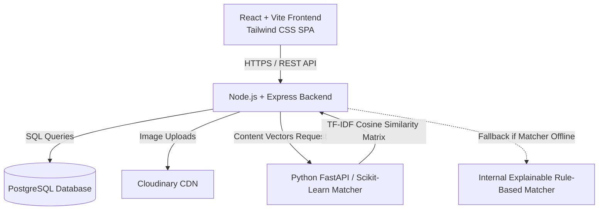

<p align="center">
  
</p>

# GreenLoop — AI-Powered Waste-to-Resource Platform

[](LICENSE)
[](client/)
[](server/)
[](server/src/db/)
[](matcher/)

> **GreenLoop** is an intelligent full-stack circular economy platform connecting households, restaurants, workshops, and commercial businesses that possess surplus, reusable discarded materials (cardboard, glass jars, timber offcuts, textile scraps, containers) directly with artisans, students, non-profits, recyclers, and creators who need them.

---

## 📌 Problem & Solution

* **The Problem:** Valuable and salvageable materials are routinely sent to landfills because owners lack a convenient, localized channel to find recipients who can repurpose them. Simultaneously, hobbyists, students, NGOs, and upcycling artisans struggle to source low-cost or free raw materials.
* **The Solution:** GreenLoop provides an intuitive web platform with verified material listings, location-based discovery, secure express-interest workflows, and a **dual-layer explainable recommendation engine** (transparent rule-based scoring with a scikit-learn TF-IDF & cosine-similarity content-based matching engine).

---

## 🏗️ System Architecture Overview



---

## 🗂️ Project Structure

```text
greenloop/
│
├── client/                     # React + Vite + Tailwind CSS frontend
│   ├── src/
│   │   ├── api/                # Axios API client & endpoint services
│   │   ├── assets/             # Static SVGs, images, and branding
│   │   ├── components/         # Modular, accessible UI components
│   │   ├── context/            # AuthContext & global state management
│   │   ├── hooks/              # Custom React utility hooks
│   │   ├── layouts/            # Navbar, footer, and shell wrappers
│   │   ├── pages/              # Landing, Auth, Listings, Details, Dashboard, Recs
│   │   ├── routes/             # Protected and public route guards
│   │   ├── utils/              # Formatters, date helpers, validation
│   │   ├── App.jsx             # Root application router
│   │   ├── main.jsx            # Entry point
│   │   └── index.css           # Tailwind directives & design tokens
│   ├── .env.example            # Frontend environment variable template
│   ├── README.md               # Frontend developer guide
│   └── package.json
│
├── server/                     # Node.js + Express REST API backend
│   ├── src/
│   │   ├── config/             # DB pool, Cloudinary, and environment configs
│   │   ├── controllers/        # Route controllers (Auth, Listings, Interests, Recs)
│   │   ├── db/                 # Schema DDL, migrations, and demo seed data
│   │   ├── middleware/         # JWT verification, upload handling, error handlers
│   │   ├── routes/             # Express route declarations
│   │   ├── services/           # Cloudinary service, rule scorer & ML proxy
│   │   ├── validators/         # Zod input validation schemas
│   │   ├── app.js              # Express app setup and middleware chain
│   │   └── server.js           # HTTP listener initialization
│   ├── .env.example            # Backend environment variable template
│   ├── README.md               # Backend developer guide
│   └── package.json
│
├── matcher/                    # Python / scikit-learn ML recommendation service
│   ├── app.py                  # Optional lightweight FastAPI microservice
│   ├── rank.py                 # TF-IDF vectorizer & cosine similarity ranking logic
│   ├── requirements.txt        # Python dependencies (scikit-learn, pandas, numpy)
│   ├── README.md               # ML module technical documentation
│   └── tests/                  # Pytest verification suite
│
├── docs/                       # Comprehensive academic & engineering documentation
│   ├── PDR.md                  # Project Design Report
│   ├── TDR.md                  # Technical Design Report
│   ├── ARCHITECTURE.md         # Full system architecture specification
│   ├── API.md                  # API endpoints, request/response contracts
│   ├── DATABASE.md             # PostgreSQL schema, relations, and indexes
│   ├── ML_RECOMMENDATION.md    # Dual-layer recommendation algorithm & math
│   ├── TEST_PLAN.md            # Test matrix, unit/integration test specifications
│   ├── DEPLOYMENT.md           # Production deployment guide (Vercel/Render/Neon)
│   ├── USER_MANUAL.md          # Step-by-step user and administrator manual
│   ├── PROJECT_PLAN.md         # Phased implementation roadmap and milestones
│   └── diagrams/               # Architecture and data flow diagrams
│
├── postman/
│   └── GreenLoop.postman_collection.json  # Complete API test collection
│
├── .gitignore                  # Git ignore rules across Node, Python, and OS
├── README.md                   # This root documentation
└── LICENSE                     # MIT License
```

---

## ⚡ Core Features

1. **User Authentication & Profiles:**
   - Role-based registration (`donor`, `recipient`, `admin`) with bcrypt password hashing and JWT issuance.
   - User profile management with preferred material categories and location/city targeting.

2. **Material Listings Lifecycle:**
   - Donors create listings with title, category, material type, condition, quantity, description, location city, and photo.
   - Image upload pipeline with Cloudinary integration and reliable local fallback.
   - Status tracking (`available`, `reserved`, `collected`, `archived`).

3. **Browse, Search & Filtering:**
   - Recipient discovery portal filtering by material category, city, condition, and full-text keyword search.
   - Pagination and responsive card grid with image previews.

4. **Interest Expression Workflow:**
   - Recipients send structured interest requests accompanied by a personalized message.
   - Donors review incoming interest requests and accept or decline.

5. **Explainable Dual-Layer Recommendation Engine:**
   - **Baseline Rule-Based Scoring (Always Available):** Transparent 100-point heuristic (Category match: 40 pts, City match: 25 pts, Keyword relevance: 20 pts, Recency: 15 pts) returning human-readable justifications.
   - **Content-Based ML Enhancement (Python / Scikit-learn):** TF-IDF vectorization across listing attributes and recipient preference vectors evaluated using Cosine Similarity.
   - **Graceful Fault-Tolerance:** Seamless fallback to baseline scoring if the Python ML microservice is unreachable.

---

## 🚀 Quick Start Guide

### Prerequisites
- **Node.js** >= 18.x
- **npm** >= 9.x
- **PostgreSQL** >= 14.x (Local instance or cloud provider like Neon / Supabase)
- **Python** >= 3.9 (for the optional ML microservice)

### 1. Database Setup
Ensure PostgreSQL is running, then create the database:
```bash
createdb greenloop
```

### 2. Backend Setup
```bash
cd server
cp .env.example .env
npm install
npm run db:migrate
npm run db:seed
npm run dev
```
Backend will listen on `http://localhost:5001`.

### 3. Frontend Setup
```bash
cd ../client
cp .env.example .env
npm install
npm run dev
```
Frontend will be available at `http://localhost:5173`.

### 4. (Optional) Python Matcher Setup
```bash
cd ../matcher
python3 -m venv venv
source venv/bin/activate
pip install -r requirements.txt
python app.py
```
Matcher microservice runs on `http://localhost:8000`.

---

## 🧭 Phased Implementation Roadmap

- [x] **Phase 0:** Project Planning & Technical Documentation (`PDR.md`, `TDR.md`, `ARCHITECTURE.md`, `PROJECT_PLAN.md`)
- [x] **Phase 1:** Repository Initialization & Full-Stack Skeleton (Vite + Tailwind, Express, Health Check)
- [x] **Phase 2:** PostgreSQL Database Layer (Schema DDL, Migrations, Seed Data, Error Handling)
- [x] **Phase 3:** Authentication & Authorization (JWT, bcrypt, Protected Routes, Auth Context)
- [x] **Phase 4:** Material Listings & Cloudinary Image Uploads (Listing CRUD, Media Service, Cards)
- [x] **Phase 5:** Browse & Interest Workflow (Search, Multi-Filter, Interest Requests, Donor Dashboard)
- [x] **Phase 6:** Explainable Recommendation Engine (Rule-based 100-pt Scorer + Python TF-IDF Cosine Matcher)
- [x] **Phase 7:** Testing, Security, Accessibility & Polish (Unit/Integration Tests, Seed Dataset, A11y)
- [x] **Phase 8:** Deployment Preparation (Vercel, Render/Railway, Managed PostgreSQL, Production Builds)
- [x] **Phase 9:** Handover, Postman Collection, User Manual & Project Presentation Script

---

## 📄 Documentation Sitemap

| Document | Purpose |
| :--- | :--- |
| [docs/PROJECT_PLAN.md](docs/PROJECT_PLAN.md) | 10-phase milestone plan, timeline, acceptance gates |
| [docs/PDR.md](docs/PDR.md) | Formal Project Design Report (stakeholders, stories, risks) |
| [docs/TDR.md](docs/TDR.md) | Technical Design Report (architecture, database, security, algorithms) |
| [docs/ARCHITECTURE.md](docs/ARCHITECTURE.md) | Deep-dive system diagrams, ER model, sequence diagrams |
| [docs/API.md](docs/API.md) | REST API contract specifications and payload examples |
| [docs/DATABASE.md](docs/DATABASE.md) | Entity relationships, indexing strategy, data dictionary |
| [docs/ML_RECOMMENDATION.md](docs/ML_RECOMMENDATION.md) | Mathematical model, TF-IDF vectorization, explainability |
| [docs/TEST_PLAN.md](docs/TEST_PLAN.md) | Manual test matrix, automated test scripts, security audit |
| [docs/DEPLOYMENT.md](docs/DEPLOYMENT.md) | Cloud hosting setup, environment variables, troubleshooting |
| [docs/USER_MANUAL.md](docs/USER_MANUAL.md) | User guides for Donors, Recipients, and Platform Admins |
| [docs/DEMO_SCRIPT.md](docs/DEMO_SCRIPT.md) | Viva presentation & demonstration script with examiner Q&A |
| [postman/GreenLoop.postman_collection.json](postman/GreenLoop.postman_collection.json) | Complete Postman collection for all endpoints |

---

## 📜 License
Distributed under the [MIT License](LICENSE).
